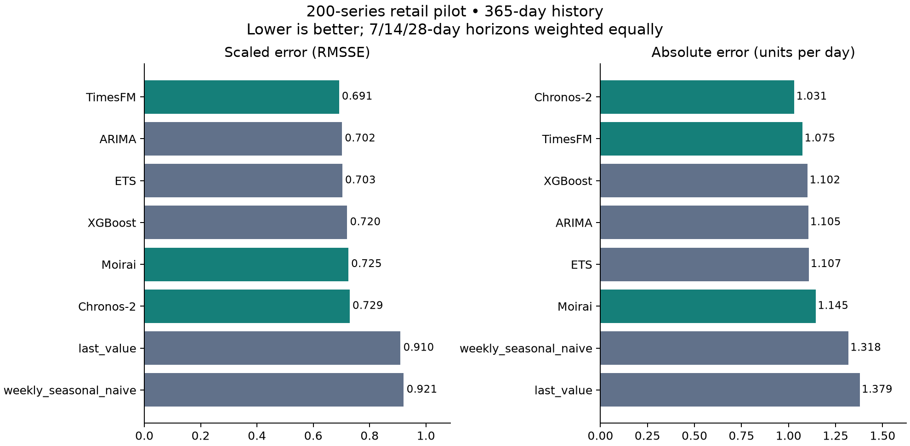

# Retail forecasting benchmark: final pilot comparison

**Completed 18 October 2026 · 200 product–store series · eight methods · four final forecast origins**

## Executive finding

Pretrained models delivered measurable accuracy gains in this pilot, but the preferred approach depends on the error measure and operating constraints. **TimesFM leads on RMSSE**, the benchmark’s prespecified validation-selection metric. **Chronos-2 leads on MAE and WAPE**, using its native median forecast. ARIMA and ETS remain competitive, inexpensive alternatives. These findings support evaluating pretrained models alongside local models; they do not establish a universal winner or quantified inventory savings.

The final tests were completed with model choices frozen beforehand. This report interprets those results without changing settings or rerunning model selection.

## What was compared

- **Reference forecasts:** last observed value and weekly seasonal naive.
- **Locally fitted statistical models:** ARIMA and ETS, fitted separately to each series.
- **Locally trained machine learning:** pooled XGBoost, learning across the pilot series.
- **Pretrained time-series models:** Chronos-2, TimesFM 2.5 and Moirai 1.1 small, with frozen checkpoints and no local fine-tuning.

The primary comparison gives every model 365 observed days of sales history. Each predicts 28 days; the 7-, 14- and 28-day results receive equal weight. Four chronological final origins span 31 January through 24 April 2016. Separate conditions use 90 and 180 days, plus a 365-day XGBoost business-feature experiment. Selection used three earlier validation origins. The diversity-balanced pilot covers all stores, states and categories, with selection based on the first 730 days; cold starts are excluded.

## Primary accuracy

| Method | RMSSE ↓ | MAE ↓ | WAPE ↓ |
| --- | ---: | ---: | ---: |
| **TimesFM** | **0.6914** | 1.0751 | 76.26% |
| ARIMA | 0.7019 | 1.1050 | 78.38% |
| ETS | 0.7029 | 1.1073 | 78.55% |
| XGBoost | 0.7203 | 1.1019 | 78.17% |
| Moirai | 0.7245 | 1.1453 | 81.24% |
| **Chronos-2** | 0.7291 | **1.0313** | **73.15%** |
| Last value | 0.9097 | 1.3791 | 97.83% |
| Weekly seasonal naive | 0.9212 | 1.3184 | 93.52% |

MAE describes average absolute daily unit error. WAPE is total absolute error divided by total demand within each horizon, then averaged equally across horizons; it is **not “percentage of forecasts wrong.”** RMSSE scales squared forecast errors by historical daily changes, making larger misses more influential while normalizing each series. This is bottom-level unweighted RMSSE, not the official hierarchical M5 WRMSSE score.

Against ARIMA, TimesFM reduces RMSSE by approximately **1.5%** and MAE by **2.7%**. Chronos-2 reduces MAE by **6.7%**, but its RMSSE is worse. Its median forecast and the other models’ documented mean estimates target different loss functions, so the report retains both the native-estimator comparison and a separate mean-only comparison excluding Chronos-2. A median can be useful for absolute-error objectives; this result does not demonstrate superiority for every inventory decision.

Paired 95% bootstrap intervals support the observed trade-off: ARIMA minus TimesFM RMSSE is **0.0106 [0.0067, 0.0146]**; Chronos-2 minus TimesFM MAE is **−0.0439 [−0.0618, −0.0256]**, while their RMSSE difference is **+0.0377 [0.0295, 0.0461]**. Negative differences favor the first model. The 2,000 bootstrap draws resample whole series, retaining origins and horizons. These are descriptive intervals, unadjusted for multiple comparisons; common store/product dependence limits broader statistical claims.

## Reliability and failures

All eight methods completed all 800 primary 365-day series/origin jobs. Across all conditions, **19,958 of 20,000 jobs succeeded (99.79%)**. The 42 failures were optimizer non-convergence in ARIMA/ETS: 20/19 at 90 days and 2/1 at 180 days. No fallback forecasts replaced them. Successful-case accuracy must therefore be read alongside coverage, especially for short histories.

For 28-day forecasts, each series’ RMSSE is first averaged over all four origins. Across those 200 series:

| Method | Median | 90th percentile | 95th percentile |
| --- | ---: | ---: | ---: |
| TimesFM | 0.7095 | 0.9440 | 1.0136 |
| ARIMA | 0.7150 | 0.9396 | 1.0072 |
| ETS | 0.7146 | 0.9398 | 1.0079 |
| XGBoost | 0.7379 | 0.9599 | 1.0550 |
| Chronos-2 | 0.7607 | 0.9987 | 1.0914 |
| Moirai | 0.7233 | 0.9476 | 1.0424 |

TimesFM’s better overall RMSSE does not mean it leads every reliability statistic: ARIMA and ETS have slightly lower 90th/95th-percentile errors at this horizon. Full 7/14/28-day reliability and win-rate tables remain in the evidence folder.

## Where the approaches worked better

The prespecified demand segments contain 114 intermittent, 40 stable and 46 volatile series. With equal horizon weights, TimesFM has the lowest RMSSE in each segment: **0.6566, 0.7079 and 0.7632**, respectively. Chronos-2 has the lowest MAE for intermittent demand (**0.8500**) and narrowly for volatile demand (**1.1780**, versus TimesFM’s **1.1793**); TimesFM leads stable-demand MAE (**1.3689**).

These are descriptive subgroup findings. The tiny volatile-demand MAE difference is not a practical superiority claim. Segment labels summarize the historical selection period, and this pilot does not establish a reliable automatic model-routing policy.

## Does less history change the answer?

The history comparison uses exactly the same **780 successful series/origin cases per horizon** across all eight methods and all three histories. It includes zero-scale cases for MAE/WAPE, so its support differs from the primary RMSSE-eligible comparison. The excluded failures remain in coverage reporting.

| Method | MAE: 90 days | MAE: 180 days | MAE: 365 days |
| --- | ---: | ---: | ---: |
| Chronos-2 | 1.0613 | 1.0481 | 1.0446 |
| TimesFM | 1.1026 | 1.0915 | 1.0896 |
| ARIMA | 1.1161 | 1.1151 | 1.1222 |
| ETS | 1.1173 | 1.1178 | 1.1246 |
| XGBoost | 1.1397 | 1.1183 | 1.1168 |
| Moirai | 1.1939 | 1.1797 | 1.1540 |

Chronos-2 and TimesFM remain strong with 90 days, but this experiment does **not** show that their advantage necessarily grows when history shrinks. Chronos-2’s MAE advantage over ARIMA is approximately 4.9% at 90 days versus 6.9% at 365 days. More history helps XGBoost and the pretrained methods here, while ARIMA/ETS show little improvement. These are limited-history experiments on established products, not true new-product or cold-start tests. RMSSE denominators change with history, so cross-history improvements are assessed using MAE/WAPE on identical targets.

## Did business features help XGBoost?

Calendar/events/SNAP and historical-price information reduced RMSSE from **0.7203 to 0.7161**, but increased MAE from **1.1019 to 1.1144** and WAPE from **78.17% to 79.05%**. The RMSSE improvement’s paired interval includes zero: univariate minus business-feature RMSSE **0.0042 [−0.0001, 0.0083]**. There is no clear all-metric benefit.

Each condition selected its own settings on validation: depth 3/300 rounds for univariate XGBoost, depth 6/200 rounds for business features. Therefore this compares two validation-selected pipelines, not a pure feature-only ablation with identical hyperparameters. Scheduled events/SNAP are assumed known at forecast time; future prices use the last observed price. Realized future prices and sales were not provided. Other models’ covariate adapters were not implemented, so this cannot rank model families under rich business information.

## Computing and deployment practicality

The four final conditions took approximately **25.7 minutes combined** on the project’s CPU laptop, including orchestration, repeated warm inference and output handling. The following are measured component totals for the primary condition, not end-to-end deployment latency:

| Method | Fit seconds (sum) | First inference seconds (sum) | Model load seconds | Peak sampled worker RSS (MiB) |
| --- | ---: | ---: | ---: | ---: |
| ETS | 2.12 | 0.33 | — | 151.8 |
| ARIMA | 14.43 | 0.59 | — | 151.8 |
| XGBoost | 1.27 | 0.05 | — | 205.3 |
| Chronos-2 | 0 | 17.82 | 2.60 | 676.8 |
| TimesFM | 0 | 38.69 | 3.04 | 1530.2 |
| Moirai | 0 | 105.75 | 3.95 | 566.5 |

Statistical models are measured per series, XGBoost in pooled jobs, and pretrained methods in batches. Fit/inference sums can include concurrent work; load is measured separately. Worker RSS excludes other processes and is not total laptop memory; reused statistical workers can retain prior allocations. These measurements should not be linearly extrapolated to the entire M5 dataset or a cloud bill.

Local methods are inexpensive in this implementation. Pretrained models avoid local fitting, but still require checkpoint downloads, version-compatible dependencies and model loading. TimesFM’s additional memory and setup effort should be weighed against its modest RMSSE gain. Moirai is slower here without an accuracy lead, and its selected checkpoint has a noncommercial license; commercial deployment would require a licensing review.

## Business recommendation

For this pilot, retain **ARIMA/ETS as inexpensive comparators**, evaluate **TimesFM when scaled-error improvement justifies additional operational effort**, and evaluate **Chronos-2 when absolute-error performance is the priority**. Keep XGBoost as a competitive locally trained approach, but do not claim that these particular business features improve it consistently.

Before recommending inventory deployment, add an explicit decision model covering lead times, stockout versus holding costs, service levels and forecast uncertainty. Forecast error reductions alone do not quantify profit, inventory reductions or customer-service gains. Budget and setup-effort measurements here are descriptive; no cloud-cost experiment or standardized person-hour study was performed.

A larger, predefined sample can check whether these findings persist with the same frozen settings. Because these test periods have now been examined, such an expansion must be described as a follow-up robustness study, not an entirely untouched new test.

## Limits and audit trail

- The balanced 200-series sample is not population-representative; cold starts and all-zero selection histories are excluded. Four final origins cannot establish performance across every retail regime.
- Moirai’s published family pretraining corpus includes M5; exact checkpoint overlap is not fully resolved. M5-disjoint pretraining is not certified for the other checkpoints either. This is not a clean proof of unseen-dataset transfer. See [pretraining audit](pretraining_audit.md).
- Conclusions apply to these checkpoints, forecast estimators and validation budgets, not every possible model in each family.
- The audit rechecked all four conditions, complete forecast grids, dates/targets, clipping and shared horizon prefixes; it independently recomputed saved scores. Frozen source/configuration and validation evidence checks passed. No model settings changed in preparing this report.
- Some paired-interval CSVs inherit the text “descriptive validation interval.” Their provenance and input paths identify them as final-test calculations; this is a display-label issue, not reuse of validation scores. Frozen reporting source was preserved.

See the [generated final score report](stage7_final_results.md), [locked protocol](evaluation_protocol.md), [execution design](stage7_design.md), and [machine-readable evidence](../results/metrics/stage7-final-57324046c857/). The generated report remains reproducible; this separate document adds interpretation without modifying the frozen experiment.
